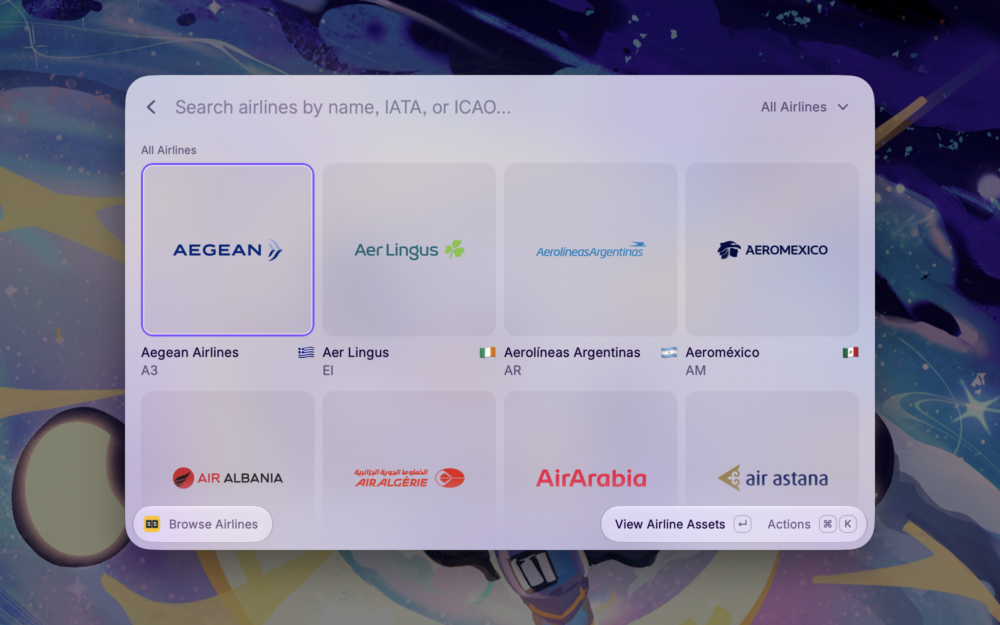

# Soaring Symbols

Browse and search a curated collection of airline branding assets — logos, icons, and tails in SVG

## Features

A fast Raycast extension for exploring airline branding assets.

- Browse curated airline logos (horizontal and stacked), icons and tails in SVG, each in color, monochrome tinted to the Raycast theme, and a version for dark backgrounds that dark mode switches to.
- See the logos an airline used before, with the years and name each was used under.
- Browse airline alliances (oneworld, SkyTeam, Star Alliance and those since disbanded), their marks and member airlines, past ones included.
- Search by name, short name (SWISS, THAI), former name, IATA or ICAO code or callsign, filter by alliance or flag carriers, and type "cargo" for cargo airlines.
- Airline details: codes, callsign, founding year, country and flag, alliance (with its mark) and former alliances, hubs, and the years flown for airlines that have ceased.
- Jump between an airline, its group, the airlines it owns or once owned, and the airline that carried it on.
- Copy or download any SVG.

## Issues

Report bugs or suggest improvements by [opening an issue](https://github.com/soaring-symbols/raycast/issues).

## License

The extension's code is [MIT](LICENSE). The airline and alliance marks it shows come from the [soaring-symbols](https://github.com/soaring-symbols/soaring-symbols) package and are trademarks of their owners, not covered by this license; read the package's [Disclaimer](https://github.com/soaring-symbols/soaring-symbols/blob/main/DISCLAIMER.md) before using them.
