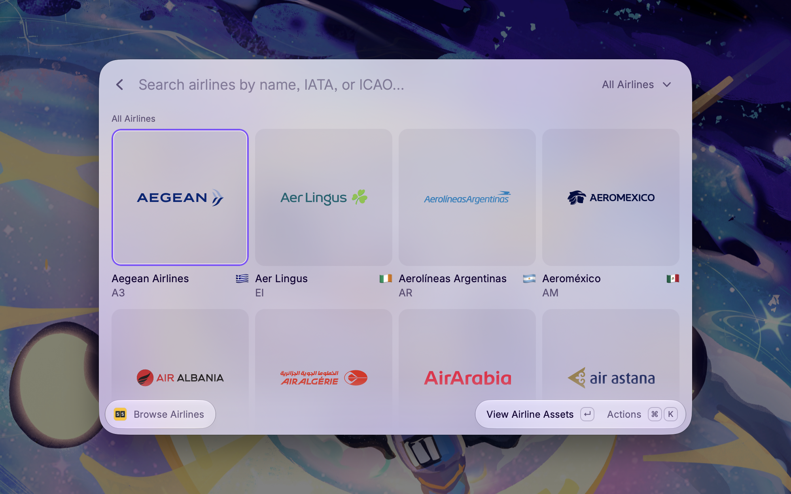

# Soaring Symbols

Browse and search a curated collection of airline branding assets — logos, icons, and tails in SVG

## Features

A fast Raycast extension for exploring airline branding assets.

- Browse curated airline logos, icons, and tails (SVG).
- Browse airline alliances (oneworld, SkyTeam, Star Alliance and those since disbanded), their marks and member airlines.
- Fast search and filters (name, code, callsign, alliance, flag carriers).
- Airline details: codes, callsign, founding year, country, alliance (with its mark) and former alliances, hubs, with airlines that no longer fly marked as ceased.
- SVG actions: copy, download, monochrome variants.

## Issues

Report bugs or suggest improvements by creating an issue [here](https://github.com/soaring-symbols/raycast/issues).
